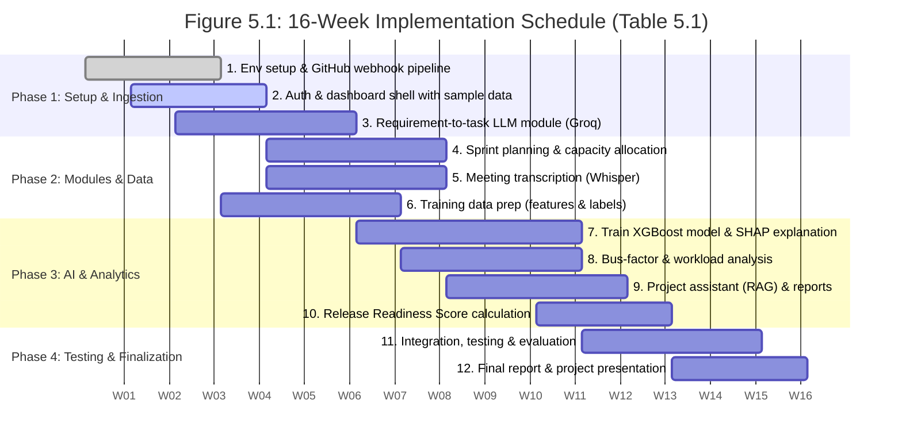
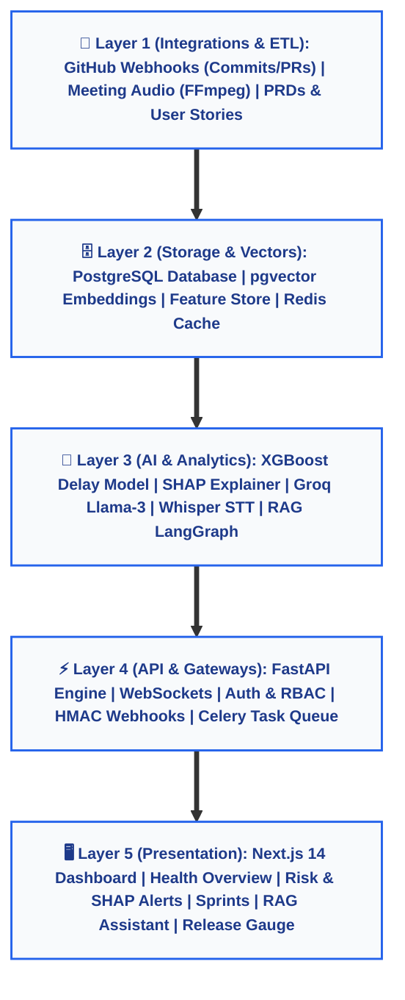
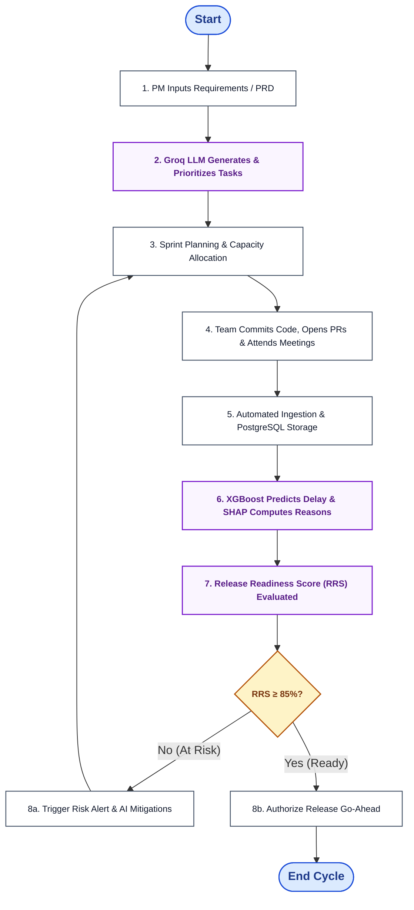
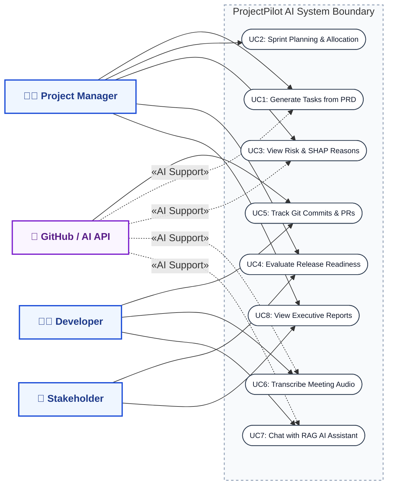
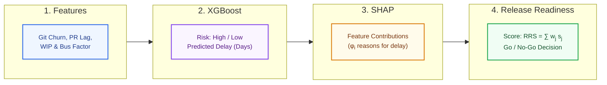
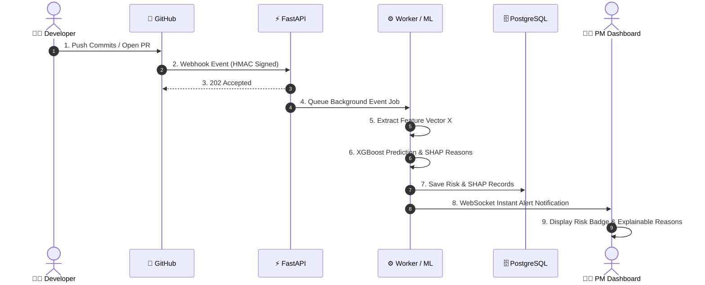
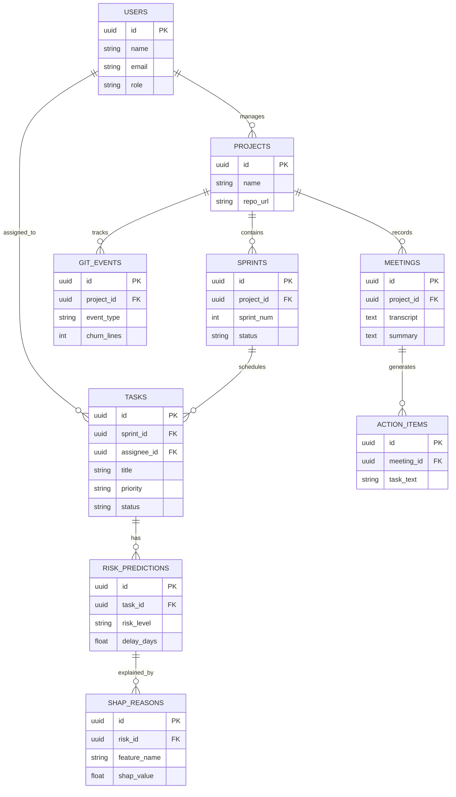
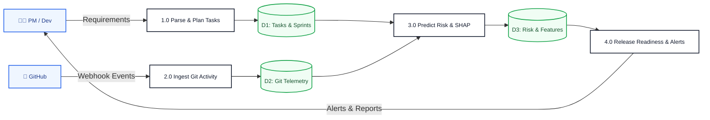
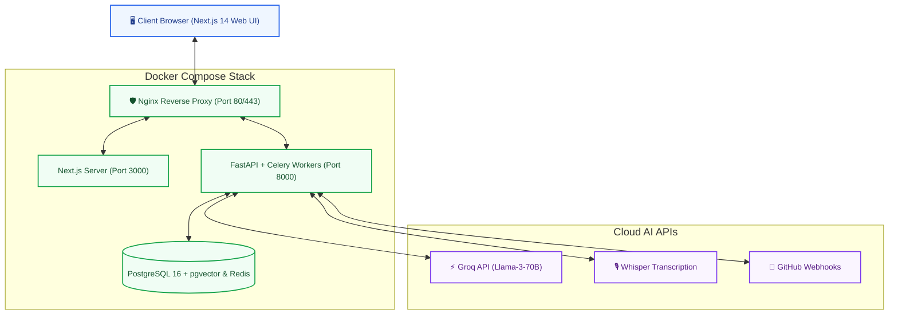

# ProjectPilot AI — Engineering Diagrams & System Architecture

This document contains all formal diagrams corresponding directly to **Chapter 3** and **Chapter 5** of the BE Project Report (`ProjectPilot_AI_Project_Report.docx`).

> 🚀 **Live Interactive Exporter (300 DPI High-Res Download):**  
> Open [http://localhost:3000/diagrams/index.html](http://localhost:3000/diagrams/index.html) or [public/diagrams/index.html](../public/diagrams/index.html) to download clean high-res PNGs and SVGs with one click.

---

## Figure 5.1: Gantt Chart for Next Semester Implementation Plan (16 Weeks)
*Strictly mapped to Table 5.1 of the Project Report.*

| Sr. | Task / Milestone | Weeks | Outcome |
| :---: | :--- | :---: | :--- |
| **1** | Set up environment, agree API contract, receive & log GitHub webhook | **1 – 3** | Working ingestion pipeline |
| **2** | Authentication and dashboard shell with sample data | **2 – 4** | Login and empty dashboard |
| **3** | Requirement-to-task generation using Groq-hosted LLM | **3 – 6** | Task generation module |
| **4** | Sprint planning module & capacity allocation | **5 – 8** | Sprint plan output |
| **5** | Meeting transcription and summary with action items (Whisper) | **5 – 8** | Meeting intelligence module |
| **6** | Prepare training data from public repos; define features & labels | **4 – 7** | Training dataset & Feature Store |
| **7** | Train XGBoost delay/risk model and add SHAP explanation | **7 – 11** | Explainable risk prediction |
| **8** | Bus-factor and workload analysis | **8 – 11** | Workload & single-point-of-failure metrics |
| **9** | Project assistant (RAG), reports and real-time notifications | **9 – 12** | AI Assistant & executive reports |
| **10** | Release Readiness Score calculation | **11 – 13** | Readiness score with reasons |
| **11** | Integration, testing and evaluation (accuracy, AUC, MAE) | **12 – 15** | Tested system & benchmarks |
| **12** | Final report and presentation | **14 – 16** | Final BE project submission & defense |

---

## Figure 3.1: System Architecture of ProjectPilot AI (Short & Compact)

---

## Figure 3.2: System Flowchart of ProjectPilot AI

---

## Figure 3.3: Use Case Diagram of ProjectPilot AI

---

## Figure 3.4: Risk Prediction, Explanation & Release Pipeline

---

## Figure 3.5: Sequence Diagram: GitHub Event to Risk Alert

---

## Figure 3.6: Database Schema / Entity-Relationship Diagram (ERD)

---

## Figure 3.7: Data Flow Diagram (DFD Level 1)

---

## Figure 3.8: Deployment & Infrastructure Topology

